# Data Intelligence e Strategia Commerciale: Analisi della Clientela di un'Azienda di Logistica

Progetto di Customer Analytics realizzato come capstone del Master in Data Science (Rome Business School), in collaborazione con un team di 7 persone. Il progetto analizza la clientela di una società italiana del settore della logistica, indicata nel testo come «l'azienda».

**Ruolo:** preparazione dei dati, dashboard Power BI e storytelling dei risultati (dettagli in «Il mio contributo»).

> **Dati non inclusi**. I dati dei clienti sono stati forniti dalla scuola a fini didattici e non sono pubblicati in questo repository, come da sua decisione. Con la sua autorizzazione sono invece pubblicati il codice, la documentazione e i risultati aggregati (grafici e screenshot delle dashboard), senza alcun dato a livello di singolo cliente. Il notebook e il modello Power BI non sono quindi rieseguibili senza il file originale: vedi «Come eseguire il notebook».

## In breve

Analisi di 20.436 clienti con 36 mesi di ricavi mensili: pulizia dei dati, indicatori comportamentali (periodo di vita, frequenza, trend del ricavo), un segnale di collasso per i clienti che il trend non coglie, dashboard Power BI e raccomandazioni commerciali nel breve, medio e lungo periodo.

- **Ricavo in ripresa, base clienti in calo**: +11,9% nell'ultimo anno (da 106,3 a 119,0 M€), ma i clienti attivi sono scesi da 15.723 a 13.874.
- **Forte concentrazione**: il 1% dei clienti (205) genera il 48,1% del ricavo dell'ultimo anno.
- **La dimensione del cliente non spiega la spesa**: il ricavo non è correlato né ai dipendenti né al fatturato dichiarato (correlazione di Spearman vicina a zero).
- **Il trend di lungo periodo non basta**: il segnale di collasso individua 1.111 clienti, di cui 223 risultano ancora «Stabili» e «Attivi».

## Contesto e obiettivo

Il settore della logistica ha assunto un ruolo sempre più strategico, spinto dalla crescita dell'e-commerce e dalla maggiore complessità delle catene di approvvigionamento. L'obiettivo è costruire una base analitica che traduca il comportamento dei 20.436 clienti in indicatori interpretabili (valore economico, settore ATECO, provincia) per supportare decisioni commerciali più efficaci. L'approccio è articolato in fasi: pulizia e controllo qualità dei dati, indicatori comportamentali, segmentazione, analisi delle tendenze e dashboard.

## Sintesi dei risultati

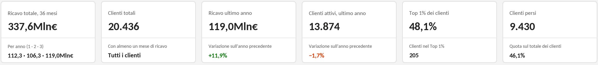

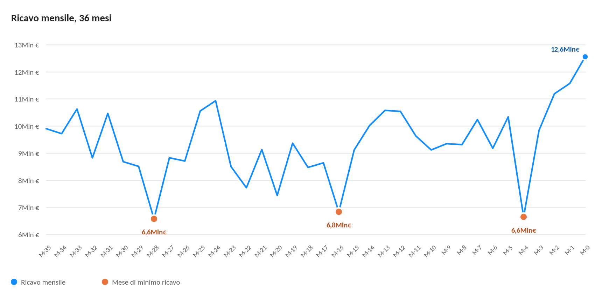

<table>
<tr>
<td>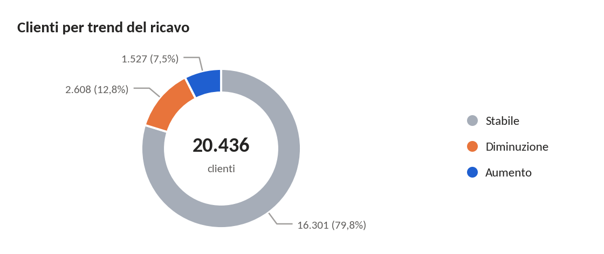</td>
<td>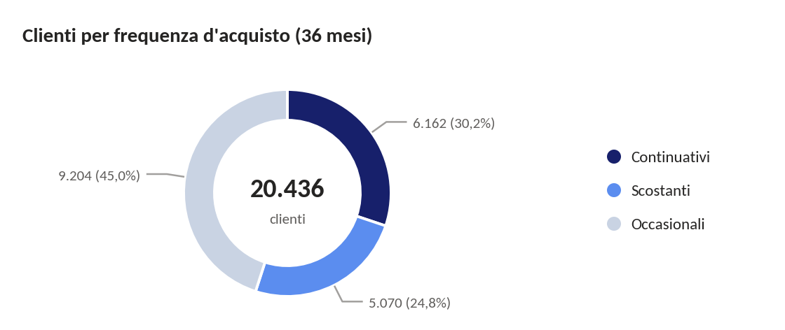</td>
</tr>
</table>

*I grafici sono ricostruiti con Python (pandas e matplotlib) a partire dal dataset di output del notebook (non incluso), nello stile delle dashboard Power BI. Lo script è in `scripts/grafici_executive_summary.py`.*

- Dopo un calo del 5,3% nel secondo anno, il ricavo dell'ultimo anno cresce, ma su una base di clienti attivi sempre più piccola (15.723 nel primo anno, 14.115 nel secondo, 13.874 nell'ultimo).
- Il ricavo scende ogni anno negli stessi mesi (M-28, M-16 e M-4: circa 6,6-6,8 M€ contro una media di ~9,4 M€), il che fa pensare a chiusure ricorrenti più che a un calo strutturale.

## Qualità dei dati

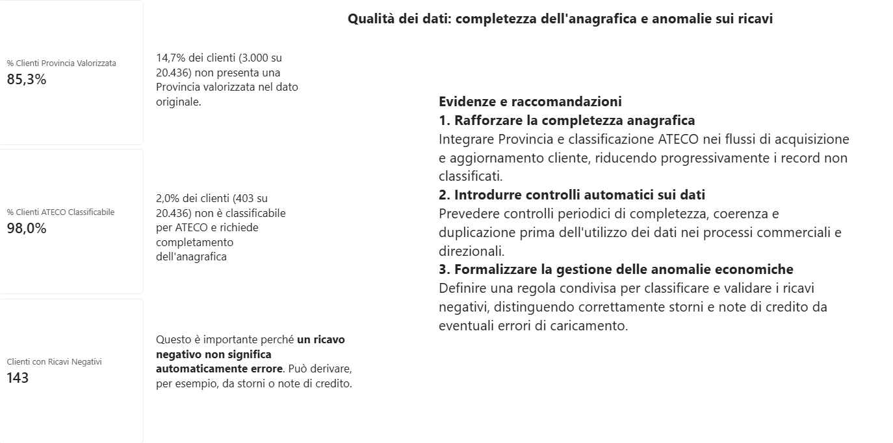

*Screenshot della dashboard Power BI.* Il 14,7% dei clienti (3.000 su 20.436) non ha una provincia valorizzata e il 2,0% (403) non è classificabile per ATECO; 143 clienti hanno almeno un mese con ricavo negativo (storni o note di credito, non errori). Le scelte di pulizia sono descritte in «Dati e metodologia» e i limiti in «Limiti del progetto».

## Profilazione territoriale

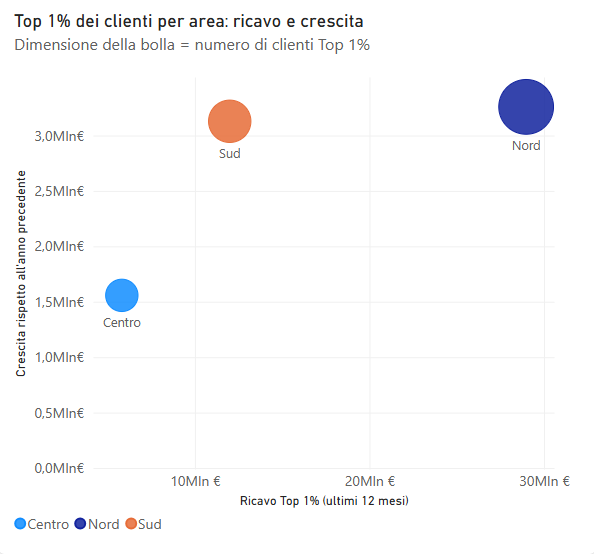

<table>
<tr>
<td>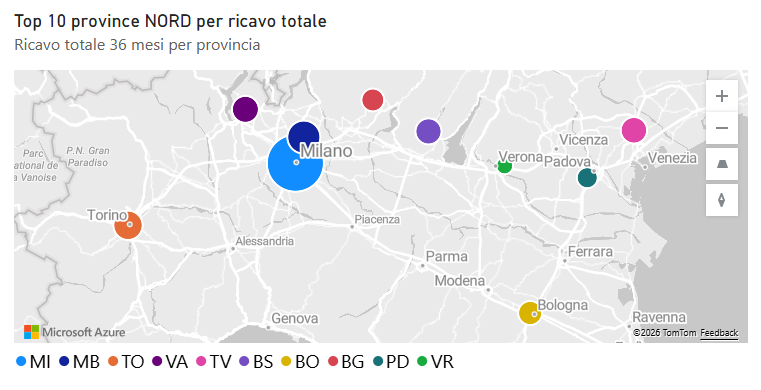</td>
<td>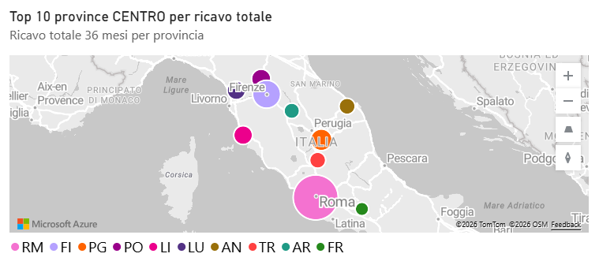</td>
<td>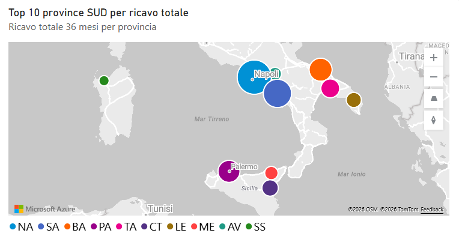</td>
</tr>
</table>

*Screenshot della dashboard Power BI. Le mappe mostrano le prime 10 province di ciascuna area per ricavo sui 36 mesi (le aree sono definite in «Dati e metodologia»).*

- **Concentrazione al Nord**: dei 205 clienti del Top 1%, 168 hanno una provincia nota: 89 sono al Nord (29,0 M€ nell'ultimo anno), 51 al Sud (12,0 M€) e 28 al Centro (5,8 M€). I restanti 37 non hanno provincia o sono all'estero.
- **Province**: Milano ha il ricavo più alto nell'ultimo anno (14,8 M€), seguita da Roma (8,3 M€), Napoli (6,2 M€) e Monza e Brianza (4,3 M€). Napoli compare in terza posizione solo dopo aver corretto la lettura della sigla `NA` (500 clienti), che in precedenza veniva scambiata per un dato mancante.
- Nella dashboard esiste anche una tabella di dettaglio per cliente, non pubblicata perché contiene dati dei singoli clienti.

## Profilazione settoriale

<table>
<tr>
<td>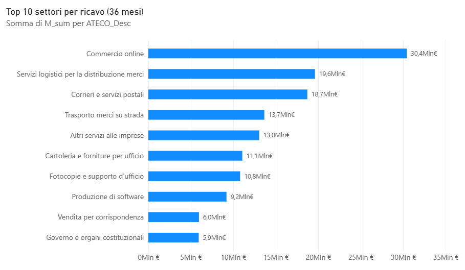</td>
<td>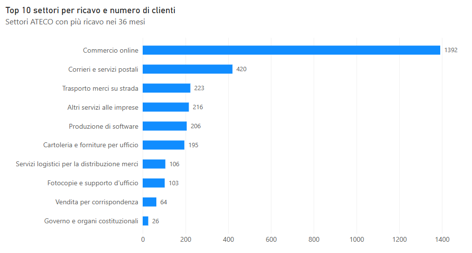</td>
</tr>
<tr>
<td>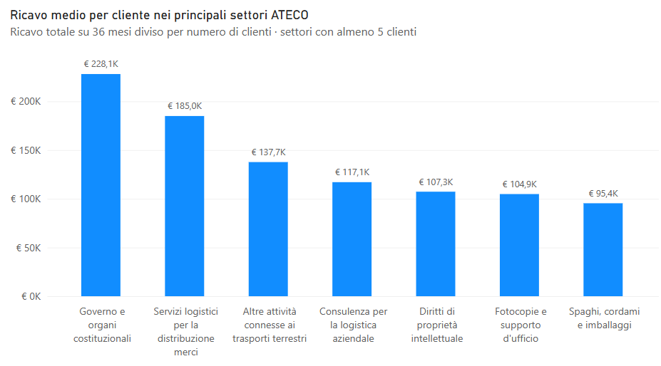</td>
<td>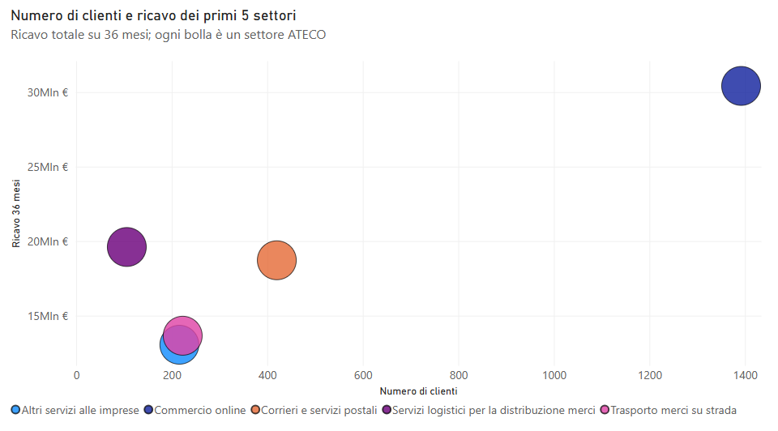</td>
</tr>
</table>

*Screenshot della dashboard Power BI. I nomi dei settori sono abbreviati nei grafici; i codici ATECO e le descrizioni ufficiali sono nella classificazione ISTAT in `data/ATECO.xlsb`.*

- **Concentrazione**: i 10 settori con più ricavo generano il 41,0% del ricavo totale sui 36 mesi con il 14,4% dei clienti.
- **Volume e valore**: il commercio online ha più clienti (1.392) e più ricavo (30,4 M€), ma un ricavo medio di circa 22 K€ per cliente. Governo e organi costituzionali (26 clienti) e servizi logistici per la distribuzione merci (106 clienti) hanno invece un ricavo medio di 228 K€ e 185 K€.
- **Soglia minima**: il ricavo medio è mostrato solo per i settori con almeno 5 clienti.

## Raccomandazioni nel breve periodo: difesa del valore

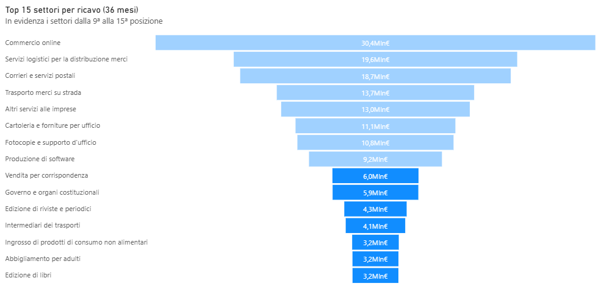

<table>
<tr>
<td>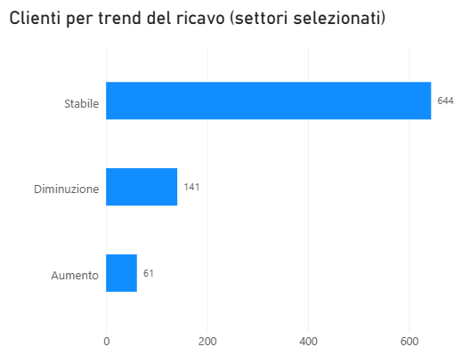</td>
<td>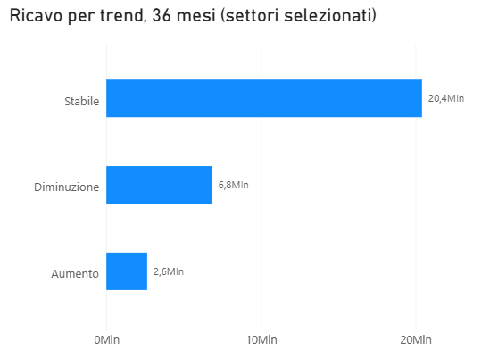</td>
</tr>
</table>

*Screenshot della dashboard Power BI, con la selezione attiva sui settori dalla 9ª alla 15ª posizione per ricavo. Il grafico con i singoli clienti in diminuzione non è pubblicato.*

- **Trend**: nei settori dalla 9ª alla 15ª posizione (846 clienti, 29,9 M€) i 141 clienti in diminuzione hanno generato 6,8 M€, circa due volte e mezzo i 61 clienti in aumento (2,6 M€). Il calo è però in gran parte già avvenuto: da 3,5 M€ nel primo anno a 0,9 M€ nell'ultimo, e 71 clienti sono già persi.
- **Azione 1, retention**: sui 70 clienti in diminuzione ancora attivi, a partire da quelli con più ricavo.
- **Azione 2, recupero**: sui 71 clienti già persi, capire le cause della contrazione e definire iniziative mirate per recuperare i volumi.

## Raccomandazioni nel medio periodo: «Protect and shift»

<table>
<tr>
<td>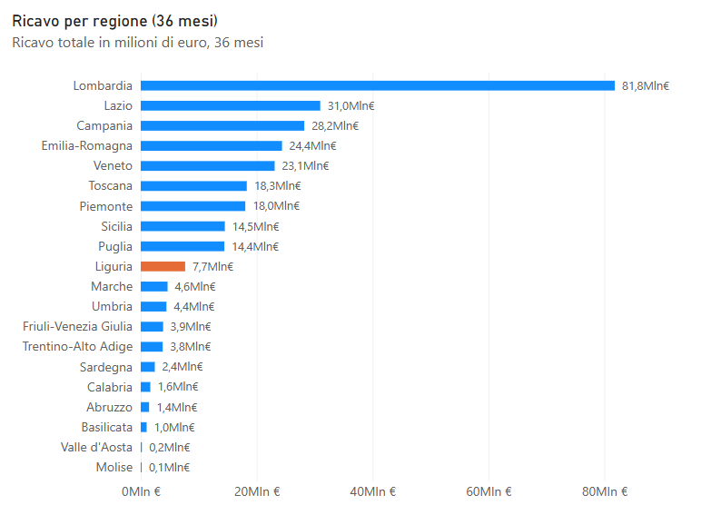</td>
<td>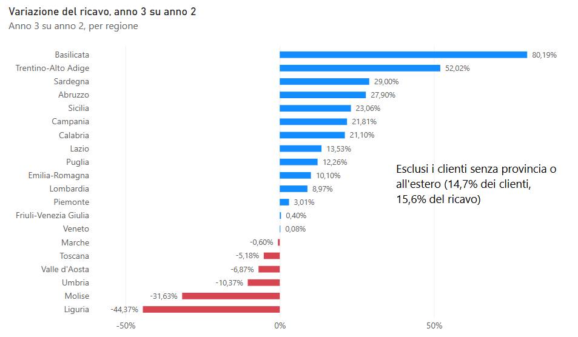</td>
</tr>
</table>

*Screenshot della dashboard Power BI. Esclusi i clienti senza provincia o all'estero (14,7% dei clienti, 15,6% del ricavo).*

- **Caso Liguria**: è la regione con il maggior calo di ricavo tra l'anno 2 e l'anno 3, sia in percentuale (−44,4%) sia in valore (−1,59 M€). La variazione dipende da una parte molto ristretta della clientela; il dettaglio per settore non è pubblicato, per ridurre il rischio di riconoscere singole aziende.
- **Il trend inganna**: il trend di lungo periodo classifica «Stabili» anche clienti il cui ricavo si è concentrato in pochi mesi e poi è crollato; il segnale di collasso, introdotto per questo motivo, li individua.
- **Azione 1**: verificare con l'area commerciale se il calo dipende da un progetto concluso o da una relazione compromessa, prima di attivare azioni di retention.
- **Azione 2**: sviluppare i settori e i clienti che crescono in regione, per ridurre la dipendenza da poche posizioni.

## Raccomandazioni nel lungo periodo: sviluppo mirato

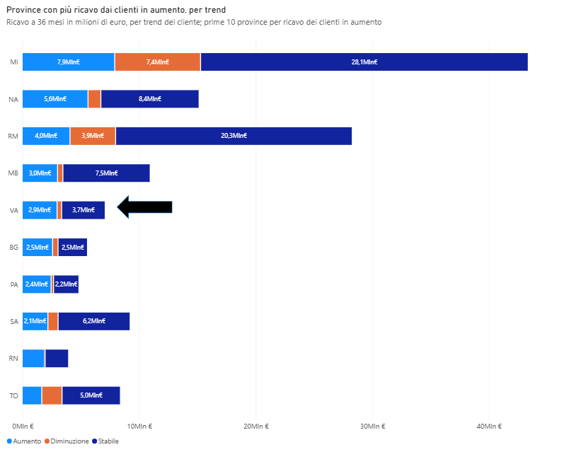

*Screenshot della dashboard Power BI. Esclusi i clienti senza provincia o all'estero (14,7% dei clienti, 15,6% del ricavo).*

- **Caso Varese**: è la 5ª provincia per ricavo dei clienti con trend in aumento (2,9 M€ in 36 mesi). I 19 clienti in aumento sono passati da 0,63 M€ nel primo anno a 1,30 M€ nell'ultimo, ma la crescita dipende da pochissimi clienti, che da soli valgono circa il 90% del ricavo in aumento della provincia. Il dettaglio per settore non è pubblicato, per ridurre il rischio di riconoscere singole aziende.
- **Azione 1, key account**: programma di fidelizzazione per i pochi clienti che concentrano la crescita.
- **Azione 2, marketing mirato**: campagne di lead generation su settori affini, dopo aver verificato se questi clienti rappresentano un segmento replicabile: la base è molto ristretta.

## Dati e metodologia

- **Dataset**: 20.436 clienti, con informazioni anagrafiche (ATECO, provincia, fatturato dichiarato, numero dipendenti) e ricavi mensili su una finestra di **36 mesi** (M-0 a M-35).
- **Fonti di riferimento**: Classificazione ATECO 2007 (ISTAT) per la standardizzazione dei settori; tabella delle province con regione e coordinate (`mapping_province.xlsx`) per le mappe e i grafici per regione nelle dashboard. La classificazione ATECO e la tabella delle province sono incluse nella cartella `data/`; il dataset clienti no.
- **Stack tecnico**: pulizia e feature engineering in **Python** (Pandas, NumPy, SciPy) su Google Colab; visualizzazione e analisi di business in **Power BI** (Power Query e DAX); grafici di sintesi in Python (matplotlib).
- **Aree geografiche delle dashboard**: Nord (Nord-ovest e Nord-est), Centro e Sud, dove il Sud comprende anche Sicilia e Sardegna. I clienti senza provincia o all'estero non hanno un'area.
- **Principio guida sulla qualità dei dati**: mai eliminare un cliente per un singolo valore mancante. I codici ATECO o le province non disponibili sono stati preservati in categorie residuali (`XXX`, `prov_non_definite`) invece di scartare il record.

### Decisioni chiave di data quality

- **Il fatturato dichiarato non è una metrica affidabile**: per il 29,5% dei clienti è pari a zero o mancante (5.232 pur avendo dipendenti), il fatturato per dipendente è molto disomogeneo (70 clienti superano i 5 milioni di euro per dipendente), e 38 clienti dichiarano meno di quanto hanno speso con l'azienda nell'ultimo anno. Inoltre misura la dimensione del cliente, non quanto genera per l'azienda. Il **ricavo generato per l'azienda** viene quindi calcolato sommando le 36 mensilità (`m_sum`), mentre i **dipendenti** sono usati come proxy della dimensione aziendale.
- **143 clienti (0,7%) presentavano valori mensili negativi**: sono stati mantenuti e interpretati come storni/note di credito, non come errori, poiché il totale per cliente resta sempre positivo.
- Le province con sigle storiche (es. FO, PS) sono state aggiornate agli standard correnti (FC, PU).
- La sigla provincia `NA` (Napoli, 500 clienti) viene letta come testo: la lettura automatica di Pandas la scambierebbe per un valore mancante.
- **23 codici ATECO** (1.102 clienti) comparivano nel dataset con descrizioni scritte in modo diverso. Sono stati ricondotti a una sola descrizione per codice (quella ISTAT più specifica), per evitare che lo stesso settore venisse spezzato in più righe nelle aggregazioni.

### Indicatori comportamentali costruiti

A partire dalle 36 mensilità sono state derivate 14 variabili (10 numeriche e 4 classificazioni), con tre segmentazioni principali:

| Dimensione | Criterio | Categorie |
|---|---|---|
| **Periodo di vita** | Anzianità (primo acquisto oltre 9 mesi fa) × Recenza (nessun acquisto negli ultimi 3 mesi = perso) | Vecchi/Recenti × Attivi/Persi |
| **Frequenza** | % di mesi attivi sui 36 mesi osservati (`pct_mesi_attivi`) | Continuativi (>80%) / Scostanti (30-80%) / Occasionali (<30%) |
| **Trend del ricavo** | Pendenza Theil-Sen + test di significatività Kendall's Tau (α=0,05, soglia 2%/mese) | Stabile / Aumento / Diminuzione |

L'uso di Theil-Sen e Kendall's Tau (invece di una semplice regressione lineare) rende il trend robusto agli outlier e comparabile tra clienti di dimensioni molto diverse.

### Segnale di collasso (integrazione al trend)

Il trend misura la pendenza di lungo periodo sui 36 mesi, quindi non coglie i clienti il cui ricavo si concentra in pochi mesi e poi crolla: la pendenza mediana resta vicina a zero e il cliente risulta "Stabile". Per questo è stato aggiunto un segnale complementare, senza modificare le segmentazioni precedenti: la variazione percentuale del ricavo tra anno 2 e anno 3 (`var_yoy_perc`) e un flag (`flag_collasso`) che segnala i clienti rilevanti (ricavo anno 2 pari o superiore al 75° percentile) il cui ricavo dell'anno 3 è sotto il 50% di quello dell'anno 2, oppure i cui ultimi 6 mesi sono sotto il 5% della propria media semestrale precedente.

Il flag segnala 1.111 clienti su 5.109 rilevanti. Di questi, 223 risultano allo stesso tempo "Stabili" e "Attivi" nelle segmentazioni precedenti, con un ricavo passato da 8,0M€ nell'anno 2 a 1,9M€ nell'anno 3.

## Limiti del progetto

- **Qualità dei dati**: valori mancanti e codifiche non uniformi hanno richiesto una pulizia estesa. Il 14,7% dei clienti (3.000) non ha una provincia identificabile e il 2,0% (403) non è classificabile per ATECO; i 143 clienti con ricavi negativi sono stati mantenuti come storni o note di credito.
- **Definizione di "attivo"**: un cliente è attivo se ha almeno un mese con ricavo maggiore di zero, anche di pochi euro (il 10% circa dei mesi con ricavo vale tra 1 e 10 €). Un cliente praticamente fermo può quindi risultare attivo; il segnale di collasso mitiga il problema ma non lo elimina.
- **Clienti recenti**: per i 2.071 clienti con primo acquisto negli ultimi 9 mesi (1.463 attivi e 608 persi) la frequenza risulta sempre «occasionale», perché è calcolata sui 36 mesi osservati, e il trend sempre «Stabile», perché la pendenza di Theil-Sen su una serie in gran parte a zero è nulla. Per questi clienti frequenza e trend non sono informativi e il periodo di vita va letto insieme alle altre segmentazioni.
- **Soglie del segnale di collasso**: sono scelte di giudizio, non derivate dai dati (parametri modificabili nel notebook), e il flag è piuttosto ampio (1.111 clienti segnalati); l'insieme più rilevante è quello dei 223 clienti "Stabili" e "Attivi" con segnale.
- **Orizzonte temporale limitato**: 36 mesi permettono di individuare trend recenti ma non di verificarne la persistenza su periodi più lunghi.
- **Privacy dei casi Liguria e Varese**: per ridurre il rischio di riconoscere singole aziende, i grafici per settore e gli importi di questi due casi non sono pubblicati; l'analisi resta a livello di regione e provincia.

## Struttura del repository

- `notebook/` — pipeline Python (Google Colab) per pulizia dati, feature engineering, segmentazione, segnale di collasso e aggregazioni
- `data/` — classificazione ATECO (`ATECO.xlsb`) e tabella delle province con regione e coordinate (`mapping_province.xlsx`, usata solo dalle dashboard Power BI); il dataset clienti (`dataset.csv`) non è incluso e il suo formato è descritto in `data/README.md`
- `output/` — documentazione del file Excel finale generato dal notebook (6 fogli: dettaglio clienti, aggregazioni per provincia/ATECO/macro area, clienti persi, rischio churn), che contiene dati dei clienti e non è incluso; le colonne sono descritte in `output/README.md`
- `scripts/grafici_executive_summary.py` — genera con pandas e matplotlib i grafici della sezione «Sintesi dei risultati»
- `dashboard/` — screenshot delle dashboard Power BI (qualità dei dati, profilazione territoriale e settoriale, raccomandazioni nel breve, medio e lungo periodo; le mappe usano le coordinate delle province incluse in `data/`) e grafici di sintesi generati dallo script
- `powerbi/` — misure DAX e query Power Query che costruiscono le dashboard, con le relazioni tra le tabelle (il file `.pbix` non è incluso: vedi `powerbi/README.md`)

## Come eseguire il notebook

Il notebook richiede il dataset dei clienti fornito dalla scuola (`dataset.csv`), che **non è incluso** nel repository. Chi dispone di un file con la stessa struttura (descritta in `data/README.md`) può rieseguire il lavoro così:

1. Installare le dipendenze con `pip install -r requirements.txt`.
2. Copiare `dataset.csv` nella cartella `data/`, accanto a `ATECO.xlsb`.
3. Aprire `notebook/analisi_segmentazione_clienti.ipynb` ed eseguire tutte le celle. Il notebook funziona sia lanciato da `notebook/` (Jupyter, VS Code) sia dalla cartella principale (Google Colab, dove basta creare la cartella `data/` nell'ambiente e caricarvi `dataset.csv` e `ATECO.xlsb`, gli unici due file letti dal notebook).

Il file Excel dei risultati viene salvato in `output/`: contiene i dati dei singoli clienti ed è escluso dal repository tramite `.gitignore` (non va mai aggiunto con `git add -f`). Per rigenerare i grafici di sintesi: `python scripts/grafici_executive_summary.py` (legge l'Excel in `output/` e scrive in `dashboard/`). Senza il dataset, i risultati si possono consultare nel notebook (con gli output salvati), nel README e negli screenshot in `dashboard/`.

## Il mio contributo

Nel progetto di gruppo ho seguito il lavoro nel suo complesso, dalla preparazione dei dati alla narrazione dei risultati. Sul codice Python ho scritto e rivisto le fasi iniziali del notebook (configurazione dell'ambiente, caricamento dei dati e pulizia delle province) e ho solamente revisionato il resto del codice; le parti statisticamente più avanzate (la regressione di Theil-Sen e il test di Kendall per il trend del ricavo) sono state sviluppate dai colleghi con più esperienza di programmazione. In Power BI sono stato tra i principali contributori allo sviluppo dell'analisi e della segmentazione e allo storytelling: la progettazione delle pagine, la scelta dei grafici e la costruzione del racconto che porta dai dati alle raccomandazioni.

## Strumenti e uso dell'intelligenza artificiale

L'analisi originale (pulizia dei dati, segmentazione, dashboard Power BI e raccomandazioni) è il lavoro del capstone svolto in team. Per preparare questo repository (riorganizzazione del notebook, segnale di collasso, correzioni sui dati, documentazione, revisione di misure e query Power BI e grafici di sintesi) mi sono fatto assistere da Claude (Anthropic). Il lavoro è stato indirizzato e controllato da me: i risultati sono stati verificati sui dati originali, il notebook rieseguito su Google Colab e i numeri confrontati con le dashboard Power BI.

## Bibliografia essenziale

Davenport & Harris (2007) *Competing on Analytics*; Wind & Cardozo (1974) *Industrial Market Segmentation*; Theil (1950), Sen (1968), Kendall (1938) per la metodologia statistica del trend; ISTAT (2022) *Classificazione ATECO 2007*.
